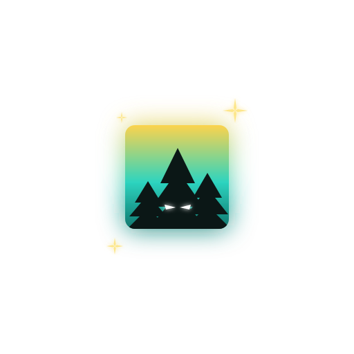

<p align="center">
  
</p>

<h1 align="center">Day Hike</h1>

<p align="center"><em>A mild morning; an easy trail; and the peculiar conviction that the woods were counting us.</em></p>

<p align="center"><a href="https://games.csarko.sh/dayhike"></a></p>

<p align="center">
<b>Play now</b> at <a href="https://games.csarko.sh/dayhike">games.csarko.sh/dayhike</a> · <b>1 to 5</b> players · <b>in the browser</b>, no account, no install · <b>free</b>
</p>

One hiker is missing, last seen at Trail 14, and the poster at the trailhead is the whole
briefing. You are the park ranger sent to find them. Lead a search party of up to five up the
trail to the crest, where the hiker is waiting, and so is whatever left them there. Then get
everyone back down to the road.

Open the link, press Play, and send the invite link to friends; they join your party from
anywhere. Walk with **WASD**, look with the mouse, run with **Shift**, jump with **Space**,
**F** for the headlamp, and **click** to search. Alone works too: the woods count one as readily
as five.

## A day on the trail

<table>
<tr>
<td width="420" valign="top"></td>
<td valign="top"><b>Morning.</b> A gravel pad, a car, a board with a poster and a map. The trail leaves the road and climbs into the trees. Birds, wind, your party's footsteps.</td>
</tr>
<tr>
<td width="420" valign="top"></td>
<td valign="top"><b>Rain.</b> A quarter of the way up the cloud closes. The rain comes through the canopy, the trail turns to mud, the drops run down the lens. Then the light goes, and the birds with it.</td>
</tr>
<tr>
<td width="420" valign="top"></td>
<td valign="top"><b>Night.</b> A pale mist rides at your sides and there are figures in it, gone when you look too long. Most are nothing. One is not. Looking costs you. On the way down it follows, faster than you walk, slower than you can run, and the road is the only ground it will not cross.</td>
</tr>
</table>

Every hike is its own forest: the world is built from a seed, so a party that sets out together
walks one world, and a new seed is a new one.

## Under the hood

Three layers, one direction of dependency: `game/ → net/ → sim/`. The simulation is pure
TypeScript with zero dependencies, steps at a fixed 60 Hz from a seed, and never imports the
renderer, which is what makes the netcode testable headless and a replay bit-identical. A match
runs peer to peer over WebRTC; a small signaling server introduces the party and steps out, so
the game costs nothing to keep online. Solo play is a host with no peers, the same code path.

Built with TypeScript, Babylon.js 9, Vite, Vitest and WebRTC. The details, from the world's
generation to the rendering to the hosting, are in [`ARCHITECTURE.md`](ARCHITECTURE.md) and
[`docs/`](docs/).

## Run it yourself

```bash
npm install      # Node >= 22.13
git lfs install  # the models and textures are LFS objects
npm run dev      # signaling server and Vite together, then open http://localhost:5173
npm test         # headless: determinism, movement, collision, the protocol, the world
```

A desktop launcher for macOS and Windows that loads the site lives in [`desktop/`](desktop/).

## License

[GPL-3.0](./LICENSE). Use it, study it, change it and share it, and share your changes under the
same terms. Third-party models and sounds are credited in [`CREDITS.md`](CREDITS.md).
